<div align="center">

# 🚑 Smart Emergency Command Center

**A web platform that coordinates a medical emergency from the patient's SOS button to the hospital's medical record.**


[Getting started](#getting-started) · [Screenshots](#screenshots) · [Architecture](#architecture) · [REST API](#rest-api) · [Documentation](#documentation-and-diagrams)

</div>

> The patient presses **SOS**, the system calculates the **priority** of the case and sends the **nearest free ambulance**, the crew sees the patient's **allergies** before giving any medication, the hospital sees the patient **before the ambulance arrives**, and the doctor's diagnosis goes into the patient's **medical history**. Dispatcher, ambulance crew, doctor, patient and administrator work in the same system, each with exactly the information needed for their role.

<p align="center">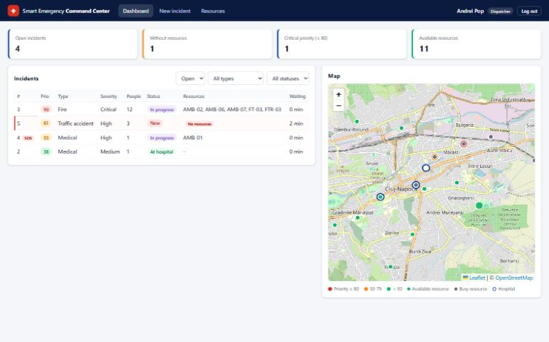</p>

| 👤 Patient | 🎧 Dispatcher | 🚑 Ambulance crew | 🩺 Doctor | ⚙️ Administrator |
|---|---|---|---|---|
| SOS button, medical card, case status (if the doctor permits) | Live map, priority queue, resource assignment | Patient medical card, vital signs, transport status | Incoming patients, treatment, diagnosis, history | Users, hospitals, resources, audit log |

---

## Contents

- [The problem](#the-problem)
- [What the application does](#what-the-application-does)
- [A complete emergency, step by step](#a-complete-emergency-step-by-step)
- [Screenshots](#screenshots)
- [Architecture](#architecture)
- [Technologies](#technologies)
- [Project structure](#project-structure)
- [Getting started](#getting-started)
- [Demo accounts](#demo-accounts)
- [Business rules](#business-rules)
- [Security and access rights](#security-and-access-rights)
- [Database](#database)
- [REST API](#rest-api)
- [Configuration](#configuration)
- [Testing](#testing)
- [Troubleshooting](#troubleshooting)
- [Documentation and diagrams](#documentation-and-diagrams)
- [Limitations and possible improvements](#limitations-and-possible-improvements)

---

## The problem

In a medical emergency every minute counts, but the information is usually spread between several people:

- the dispatcher does not always know which ambulance is **free and closest**;
- several emergencies arrive at the same time and must be handled **in the right order**;
- the ambulance crew arrives **without knowing the allergies or the medication** of the patient;
- the hospital learns about the patient **only when the ambulance is at the door**;
- after the emergency, the diagnosis is not linked to the patient's **medical history**.

SECC puts all the participants in one system: the location of the patient, the priority of every case, the position of every ambulance, the Medical Card and the measurements made on the way are visible, in real time, to everyone who needs them.

## What the application does

| User | Main features |
|---|---|
| **Patient** | SOS button that sends the GPS location · choose the type of emergency and add a note · cancel a request sent by mistake (until the crew arrives) · follow the emergency status *(if the doctor permits)* · read the Medical Card and Medical History · manage up to 5 emergency contacts |
| **Dispatcher** | Dashboard with all open incidents ordered by priority and a live map · create incidents reported by phone and edit them · **Smart Dispatch** recommendation of the closest suitable resources · assign resources (recommended or manual) · manage ambulances, fire teams, fire trucks and police units · close incidents |
| **Ambulance crew** | Assigned emergency appears automatically (**NEW EMERGENCY**) · patient's Medical Card with allergies in red · one button for the next transport step · record vital signs, medication and interventions (abnormal values in red) · choose the hospital · hand the patient over |
| **Doctor** | Incoming patients with estimated arrival time · Medical Card, history, transport timeline and vital signs on one page · diagnosis and treatment with **allergy warning** · allow the patient to see the status · finalize the case (added to the medical history) |
| **Administrator** | User accounts (create, edit, reset password, disable) · link crews to ambulances and doctors to hospitals · system status · audit log with CSV export |

## A complete emergency, step by step

| # | Who | Action | What the others see |
|---|---|---|---|
| 1 | Patient | Presses **SOS** | The incident appears on the dispatcher dashboard; the nearest free ambulance gets **NEW EMERGENCY** |
| 2 | Crew | Reads the Medical Card, presses *En route* and *Arrived on scene* | Dispatcher and patient see the transport status |
| 3 | Crew | Records vital signs, starts the transport to a hospital | The patient appears in the doctor's *Incoming patients* with ETA |
| 4 | Crew | *Arrived at hospital*, *Hand over to hospital* | The ambulance is available again; the transport record is locked |
| 5 | Doctor | Checks the card, saves diagnosis and treatment, finalizes the case | The patient sees the new entry in the medical history |
| 6 | Dispatcher | Closes the incident marked *Ready to close* | All remaining resources are released |

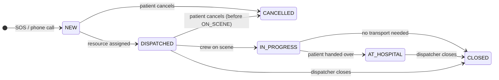

## Screenshots

All screenshots were taken in the running application with real data (Cluj-Napoca demo data). The red numbers are explained in [the documentation](docs/SECC_Documentation.docx).

| Patient - SOS | Patient - emergency status |
|---|---|
| 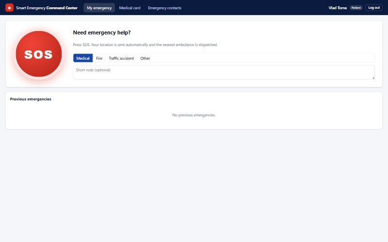 | 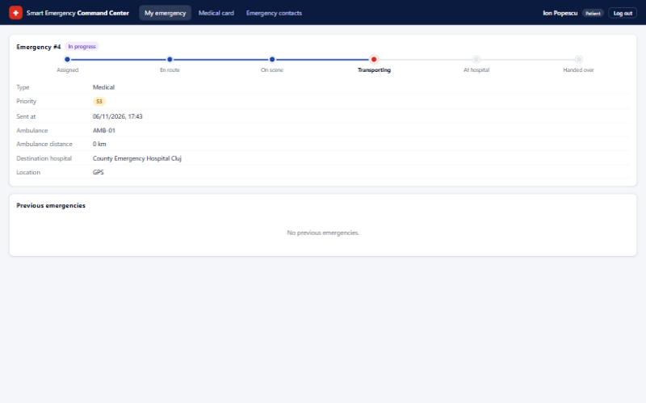 |

| Dispatcher - incident with Smart Dispatch recommendation | Ambulance crew - new emergency |
|---|---|
| 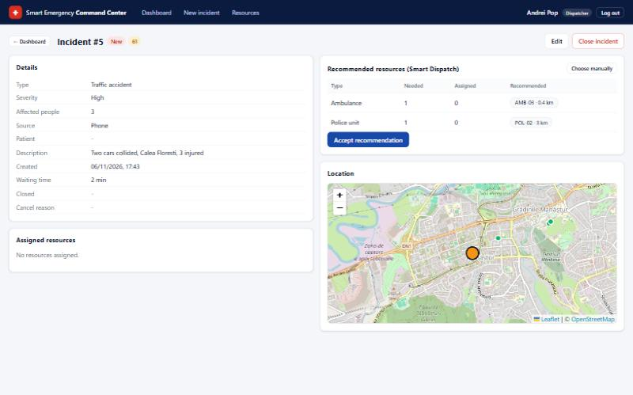 | 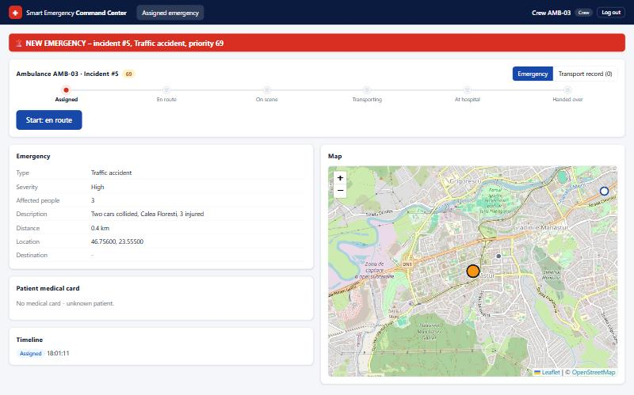 |

| Ambulance crew - patient Medical Card (allergy in red) | Ambulance crew - transport record |
|---|---|
| 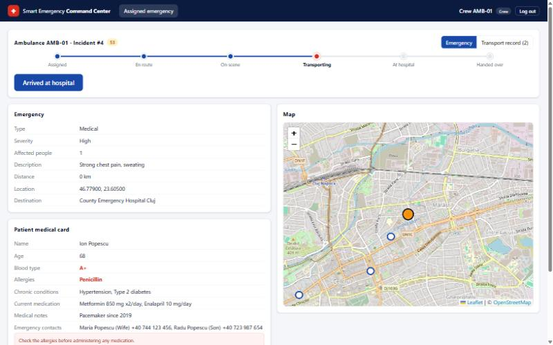 | 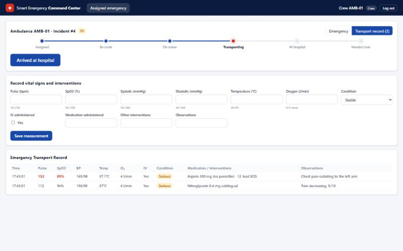 |

| Doctor - patient page with allergy warning | Administrator - user accounts |
|---|---|
| 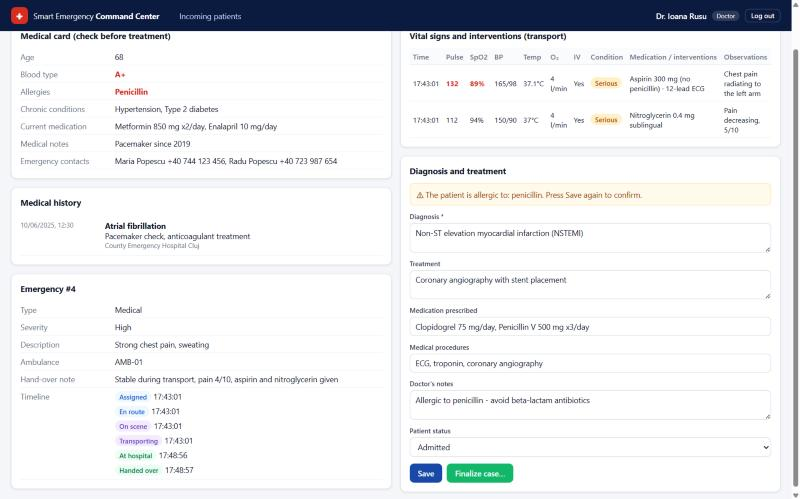 | 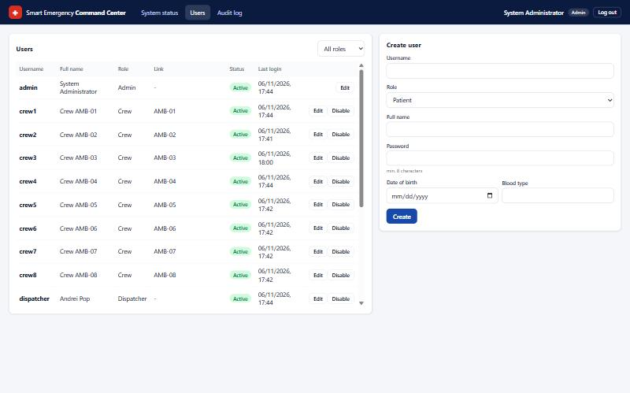 |

## Architecture

Three tiers: a **React** single page application in the browser, a **Spring Boot** REST API, and a **SQL Server** database.

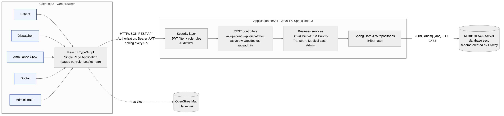

- **Presentation tier** (`frontend/`): pages for each role, a REST client that adds the JWT token to every request, an authentication context and a Leaflet/OpenStreetMap map. It contains no business rules. Operational pages refresh themselves every 5 seconds (polling).
- **Application tier** (`backend/`): security filters (JWT authentication, role rules, audit), REST controllers (one per role), business services (Smart Dispatch & Priority, transport, medical case, administration) and Spring Data JPA repositories.
- **Data tier**: SQL Server database `secc` with 13 tables. The schema is versioned with Flyway and created automatically at the first start; demo data is inserted by `DataSeeder`.

**How a request is processed**

1. The browser sends `HTTP + JSON` with `Authorization: Bearer <JWT>` (in development Vite forwards `/api` to port 8080).
2. `JwtAuthFilter` validates the token, loads the user and rejects disabled accounts.
3. `SecurityConfig` checks that the role may call the path (`/api/patient/**`, `/api/dispatcher/**`, ...).
4. The controller validates the body (Bean Validation) and calls the service.
5. The service applies the business rules inside a transaction and uses the repositories.
6. The result is returned as JSON; errors are returned as `{"message": ...}` with status 400 / 403 / 404 / 409.
7. `AuditFilter` writes the request in the audit log.

More diagrams (flow charts, class, object, sequence, activity, state, package, communication, component, deployment, relational) are in [`docs/diagrams`](docs/diagrams).

## Technologies

| Layer | Technology |
|---|---|
| Frontend | React 18, TypeScript 5, Vite 5 (Node.js), React Router 6, Leaflet + react-leaflet, OpenStreetMap |
| Backend | Java 17, Spring Boot 3.3 (Web, Data JPA, Security, Validation), Hibernate 6, JJWT 0.12, BCrypt, Lombok, Flyway |
| Database | Microsoft SQL Server 2019/2022, managed with SQL Server Management Studio |
| Build | Maven, npm |

## Project structure

```
.
├── backend/                         Spring Boot application
│   ├── pom.xml
│   ├── sql/create_database.sql      one-time SQL Server setup (database + login)
│   └── src/main/
│       ├── java/com/smartemergency/
│       │   ├── config/              SecurityConfig, JWT, AuditFilter, DataSeeder
│       │   ├── domain/              JPA entities and enums
│       │   ├── repo/                Spring Data repositories
│       │   ├── service/             business logic (DispatchService, PriorityCalculator, ...)
│       │   └── web/                 REST controllers, DTOs, error handling
│       └── resources/
│           ├── application.yml
│           └── db/migration/V1__schema.sql
├── frontend/                        React + TypeScript client
│   └── src/
│       ├── pages/                   patient, dispatcher, crew, doctor, admin
│       ├── components/              Layout, MapView, VitalsTable, ui, hooks
│       ├── api.ts, auth.tsx         REST client and login state
│       └── types.ts                 TypeScript types of the API
├── docs/                            documentation, diagrams, screenshots
├── scripts/e2e-test.sh              automatic test of the main scenario
└── start.bat                        starts backend + frontend on Windows
```

## Getting started

### Requirements

- **JDK 17+** and **Maven 3.9+** (or IntelliJ IDEA)
- **Node.js 18+** with npm
- **Microsoft SQL Server** (Express or Developer) and **SQL Server Management Studio**

> `mvn -version` must show Java 17 or newer. The `java` command on the PATH may be older; Maven uses `JAVA_HOME`.

### 1. Database (once)

1. Open SSMS, connect with Windows Authentication, open [`backend/sql/create_database.sql`](backend/sql/create_database.sql) and run it (**F5**, whole script). It creates the database `secc` and the login `secc` / `Secc_Pass2026!`.
2. If the last query returns `windows_auth_only = 1`: server **Properties → Security → SQL Server and Windows Authentication mode**, then restart the server.
3. Enable TCP/IP: **Win + R → `SQLServerManager16.msc`** → *SQL Server Network Configuration → Protocols for MSSQLSERVER* → **TCP/IP → Enable**; in *TCP/IP → IP Addresses → IPAll* set **TCP Port = 1433** and leave *TCP Dynamic Ports* empty; restart the SQL Server service.
4. Check: `Test-NetConnection localhost -Port 1433` in PowerShell must show `TcpTestSucceeded : True`.

The tables are created by Flyway when the backend starts; demo data is inserted automatically into an empty database.

### 2. Run

**Windows, one click:** double-click `start.bat`. It starts the backend and the frontend in two windows, waits until the backend answers and opens http://localhost:5173. Logs are written to `logs/`.

**Manually:**

```bash
# terminal 1
cd backend
mvn spring-boot:run          # http://localhost:8080

# terminal 2
cd frontend
npm install
npm run dev                  # http://localhost:5173
```

Open **http://localhost:5173** and log in with a demo account.

### 3. Production build

```bash
cd backend && mvn package            # target/secc-backend-1.0.0.jar  ->  java -jar ...
cd frontend && npm run build         # static files in frontend/dist (serve with any web server, proxy /api to the backend)
```

## Demo accounts

Password for all accounts: **`password123`**

| Username | Role | Notes |
|---|---|---|
| `patient1` | Patient | Ion Popescu - Medical Card with **penicillin allergy**, contacts, history |
| `patient2`, `patient3` | Patient | Maria Ionescu (asthma), Vlad Toma |
| `dispatcher`, `dispatcher2` | Dispatcher | |
| `crew1` … `crew4` | Ambulance crew | linked to AMB-01 … AMB-04 (create `crew5`… for AMB-05… from the admin page) |
| `doctor1`, `doctor2`, `doctor3` | Doctor | County Emergency / Municipal / Military Hospital Cluj |
| `admin` | Administrator | |

Tip: use normal + private browser windows (or two browsers) to be logged in with several roles at the same time.

## Business rules

**Priority score (0-100)** - [`PriorityCalculator.java`](backend/src/main/java/com/smartemergency/service/PriorityCalculator.java)

| Component | Points |
|---|---|
| Severity | Low 15 · Medium 30 · High 45 · Critical 60 |
| Affected people | 2 per person, max 20 |
| Type | Fire, Building collapse 10 · Traffic accident, Flood 8 · Medical 6 · Other 4 |
| Waiting | 1 per minute without resources, max 10 |

Example: critical fire, 12 people, waiting 4 minutes → 60 + 20 + 10 + 4 = **94**. The dashboard is ordered by this score (red ≥ 80, orange 50-79, green < 50).

**Smart Dispatch** - [`DispatchRules.java`](backend/src/main/java/com/smartemergency/service/DispatchRules.java), [`DispatchService.java`](backend/src/main/java/com/smartemergency/service/DispatchService.java)

- Ambulances = ⌈affected people / 4⌉, between 1 and 3.
- Fire: + 1 fire team + 1 fire truck · Traffic accident: + 1 police unit · Building collapse: + 1 fire team + 1 police unit · Flood: + 1 fire team.
- For each needed type, the AVAILABLE units closest to the incident are recommended (Haversine distance, R = 6371 km). Already assigned units are counted.
- An SOS request automatically gets the nearest available ambulance.
- Selected resources are locked in the database (pessimistic lock); if another dispatcher took one in the meantime, the assignment is rejected with 409.

**Transport status** - only the next step is accepted:
`ASSIGNED → EN_ROUTE → ON_SCENE → TRANSPORTING → AT_HOSPITAL → HANDED_OVER` (or `NO_TRANSPORT` / `CANCELLED`).

**Vital signs** - accepted ranges: pulse 20-250, SpO2 50-100, systolic 50-260, diastolic 30-160, temperature 30-45 °C. Shown in red: pulse < 50 or > 120, SpO2 < 92, systolic < 90 or > 180, temperature > 38.5.

**Other rules**: a patient may cancel only before the crew is on scene; an incident cannot be closed while a transport is active; the transport record is locked at hand-over; a finalized medical case is read-only and is added to the medical history.

## Security and access rights

- Passwords stored as **BCrypt** hashes.
- **JWT** (HMAC-SHA, 8 hours) returned at login and sent with every request.
- Every `/api/<role>/**` path is reserved to one role ([`SecurityConfig.java`](backend/src/main/java/com/smartemergency/config/SecurityConfig.java)); the user is always taken from the token, never from a request parameter.
- A crew sees only the emergency of its ambulance, a doctor only the patients sent to his hospital, a patient only his own data.
- A disabled account is rejected at the next request, even with a valid token.
- Every login, failed login and request is written to the **audit log**.

| Data | Patient | Dispatcher | Crew | Doctor | Admin |
|---|---|---|---|---|---|
| Emergency status | R (own) | R | R (assigned) | R (incoming) | - |
| Incidents, resources | - | R/W | R (own) | R | - |
| Medical Card | R (own) | - | R | R/W | create empty |
| Medical History | R (own) | - | - | R/W | - |
| Vital signs, transport | R (status) | R (status) | R/W | R | - |
| Diagnosis, medical case | - | - | - | R/W | - |
| Users, audit log | - | - | - | - | R/W |

## Database

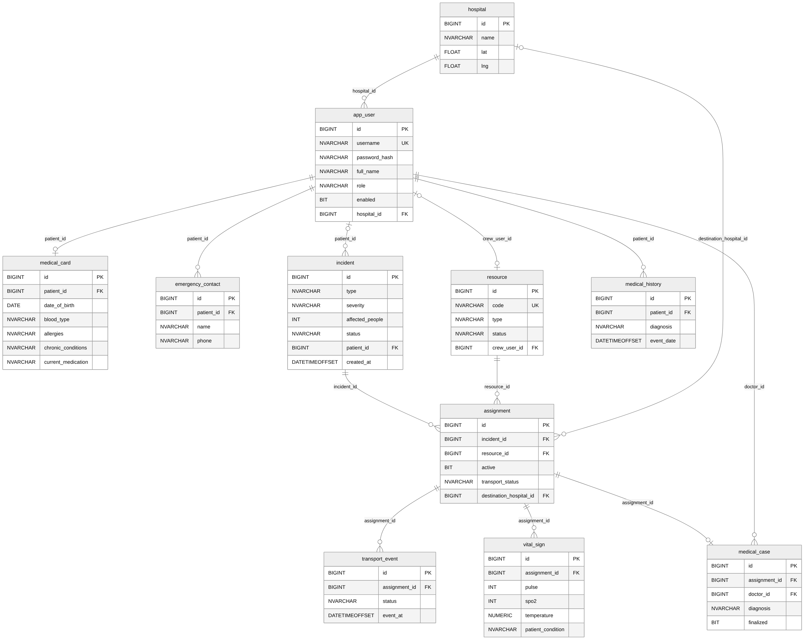

| Table | Content |
|---|---|
| `app_user` | accounts: username, BCrypt hash, full name, role, enabled, hospital (doctors) |
| `hospital` | hospitals with GPS coordinates |
| `medical_card` | blood type, allergies, chronic conditions, medication, notes, home location |
| `emergency_contact` | up to 5 contacts per patient |
| `incident` | type, severity, affected people, location, source (SOS / PHONE), status, timestamps |
| `resource` | ambulances, fire teams, fire trucks, police units; crew account for ambulances |
| `assignment` | resource assigned to an incident; transport status and destination for ambulances |
| `transport_event` | timeline of transport statuses |
| `vital_sign` | measurements of the Emergency Transport Record |
| `medical_case` | diagnosis, treatment, medication, procedures, patient status |
| `medical_history` | finalized medical events of a patient |
| `audit_log` | logins and requests |
| `app_setting` | key/value settings |

Schema: [`V1__schema.sql`](backend/src/main/resources/db/migration/V1__schema.sql). To reset all data, drop and recreate the database `secc` (or run the setup script again on an empty database) and restart the backend.

## REST API

All endpoints are under `/api`, exchange JSON and (except login) require `Authorization: Bearer <token>`.

| Use case | Endpoint | Role |
|---|---|---|
| Login / current user | `POST /api/auth/login`, `GET /api/auth/me` | all |
| Hospitals | `GET /api/common/hospitals` | all |
| SOS | `POST /api/patient/emergencies` | Patient |
| Emergency status / history | `GET /api/patient/emergencies/current`, `GET /api/patient/emergencies` | Patient |
| Cancel | `POST /api/patient/emergencies/{id}/cancel` | Patient |
| Medical Card and history | `GET /api/patient/medical-card` | Patient |
| Emergency contacts | `GET, POST /api/patient/contacts`, `PUT, DELETE /api/patient/contacts/{id}` | Patient |
| Incidents | `GET, POST /api/dispatcher/incidents`, `GET, PUT /api/dispatcher/incidents/{id}` | Dispatcher |
| Assign / close | `POST /api/dispatcher/incidents/{id}/assign`, `POST /api/dispatcher/incidents/{id}/close` | Dispatcher |
| Resources | `GET, POST /api/dispatcher/resources`, `PATCH /api/dispatcher/resources/{id}/status` | Dispatcher |
| Patient search | `GET /api/dispatcher/patients?q=` | Dispatcher |
| Assigned emergency | `GET /api/crew/assignment` | Crew |
| Transport | `POST /api/crew/assignment/status`, `.../vitals`, `.../handover`, `.../no-transport` | Crew |
| Incoming patients | `GET /api/doctor/incoming` | Doctor |
| Patient data | `GET /api/doctor/patients/{assignmentId}` | Doctor |
| Medical case | `PUT /api/doctor/patients/{id}/case`, `POST /api/doctor/patients/{id}/case/finalize` | Doctor |
| Users | `GET, POST /api/admin/users`, `PUT /api/admin/users/{id}`, `POST /api/admin/users/{id}/enabled` | Admin |
| Status / audit | `GET /api/admin/status`, `GET /api/admin/audit`, `GET /api/admin/audit/export` | Admin |

Example:

```bash
TOKEN=$(curl -s -X POST localhost:8080/api/auth/login -H 'Content-Type: application/json' \
  -d '{"username":"patient1","password":"password123"}' | jq -r .token)

curl -s -X POST localhost:8080/api/patient/emergencies -H "Authorization: Bearer $TOKEN" \
  -H 'Content-Type: application/json' -d '{"type":"MEDICAL","note":"Chest pain","lat":46.779,"lng":23.605}'
```

## Configuration

`backend/src/main/resources/application.yml` - every value can be overridden with an environment variable:

| Variable | Default |
|---|---|
| `DB_URL` | `jdbc:sqlserver://localhost:1433;databaseName=secc;encrypt=true;trustServerCertificate=true` |
| `DB_USER` / `DB_PASSWORD` | `secc` / `Secc_Pass2026!` |
| `JWT_SECRET` | development secret - **change it in production** (min. 32 characters) |

For a named SQL Server instance use `jdbc:sqlserver://localhost;instanceName=SQLEXPRESS;databaseName=secc;encrypt=true;trustServerCertificate=true` (requires the SQL Server Browser service). Set `secc.seed-demo-data: false` to start without demo data.

## Testing

[`scripts/e2e-test.sh`](scripts/e2e-test.sh) runs the main scenario against a running backend on a **freshly seeded** database (needs `curl` and `jq`, e.g. Git Bash or WSL): login, role checks, SOS and automatic dispatch, invalid transitions, vital-sign validation, hand-over, doctor case and history, Smart Dispatch recommendation, double assignment, admin functions.

```bash
./scripts/e2e-test.sh
```

## Troubleshooting

| Problem | Solution |
|---|---|
| `The TCP/IP connection to the host localhost, port 1433 has failed` | TCP/IP is disabled or SQL Server uses another port - see *Getting started → Database*, step 3. |
| `Login failed for user 'secc'` | Enable *SQL Server and Windows Authentication mode* and restart SQL Server. |
| `Database 'secc' does not exist` in SSMS | Run the **whole** setup script (Ctrl+A, F5). |
| `release version 17 not supported` | Maven runs with an old JDK - install JDK 17+ and set `JAVA_HOME`. |
| `Failed to load driver class org.postgresql.Driver` | Old build output - run `mvn clean spring-boot:run`. |
| Map is grey | The browser has no access to `tile.openstreetmap.org`. |
| Browser location is not used | Geolocation works only on `localhost` or over HTTPS; otherwise the home address of the patient is used. |

## Documentation and diagrams

| File | Content |
|---|---|
| [`docs/SECC_Documentation.docx`](docs/SECC_Documentation.docx) | **Project documentation (12 pages)** - problem, how the application works with annotated screenshots, use cases, architecture, flow chart, class diagram, database, rules, installation, glossary |
| [`docs/SECC_Documentation_Full.docx`](docs/SECC_Documentation_Full.docx) | Complete documentation (~50 pages) - every use case described step by step, all UML diagrams, REST API, glossary |
| [`docs/diagrams/`](docs/diagrams) | All diagrams as PNG + Mermaid sources (`.mmd`): use cases, architecture, flow charts, class, object, sequence, activity, state, package, communication, component, deployment, relational |
| [`docs/screenshots/`](docs/screenshots) | Screenshots of the running application; `annotated/` contains the versions with numbered callouts |

Diagrams can be regenerated with the Mermaid CLI: `npx @mermaid-js/mermaid-cli -i docs/diagrams/03_class.mmd -o class.png`.

## Limitations and possible improvements

- Real-time updates use polling every 5 seconds; WebSockets / Server-Sent Events would scale better.
- Ambulance positions are updated only at status changes (on scene, at hospital); a real system would use GPS tracking from the vehicle.
- The "patient can view status" permission of the doctor is described in the requirements; in the current code the patient sees the status immediately.
- No telephony or radio integration, no high availability, not certified for real emergency use - this is a prototype.
- The map needs internet access to OpenStreetMap.

---

Author: **Ariana Daboc**
